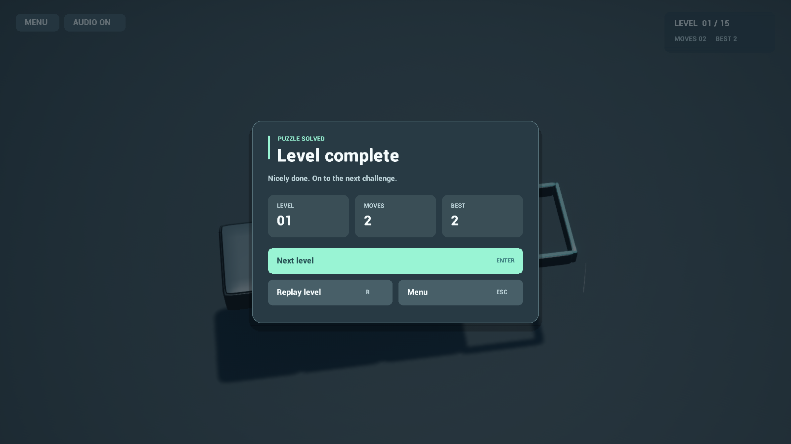
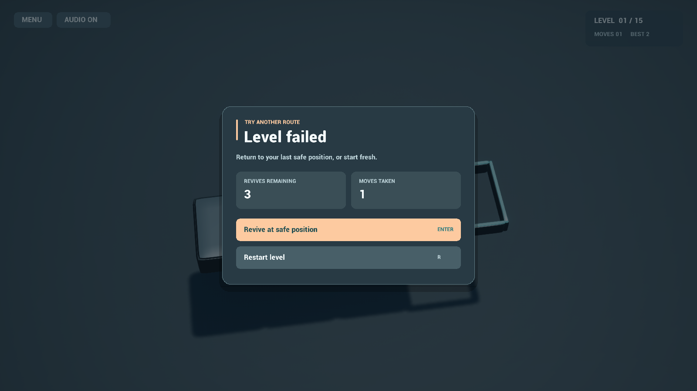

# UI, VFX and ambient audio update

## Gameplay interface

The former title/subtitle and all bottom-left instructions are removed. Gameplay displays compact Menu/Audio controls and level/move/best information. Controls are explained in the pause panel instead of covering the board.

Completion/failure cards use rounded panels, a short fade/slide entrance, stronger typography, separate metric cards and explicit primary actions. Completion offers Next level, Replay and Menu. Failure offers Revive while available, otherwise Restart; the skip-to-next-level action was removed from failure. Background controls do not receive clicks through a modal panel. Text uses the bundled engine Roboto distance-field font; its content directory is explicitly included in cook settings.

HUD rendering lives in `BloxorzHUD.cpp`, separate from controller input/game-mode lighting. Existing keyboard bindings remain unchanged. Audio toggles mute both gameplay cues and music. The old internal save-slot name is deliberately retained so removing the visible branding does not erase existing progress.

## Feedback

Landings use a small contact pulse and short, bounded gold sparks. Switch changes also pulse affected bridge groups. Falling gives a brief warm pulse at the departure cell; reviving gives a teal arrival pulse. Completion combines a wider mint pulse, a smaller spark burst and reduced-scale Niagara feedback. Pulse instances are capped at eight simultaneous rings; sparks are capped at 64, and neither casts shadows. Optional designer-assigned landing Niagara remains available, but the default white landing template is no longer auto-spawned.

These are presentation-only consumers of resolved puzzle events; they do not affect grid state, pivots, support checks or win conditions.

## Music

`/Game/Audio/AmbientPuzzle` is an original synthesized 32-second stereo ambient loop: warm pads and sparse soft arpeggios, without drums or third-party samples. The waveform is normalized with headroom, uses a circular chord/note progression and starts with a two-second fade. The loop continues across level changes/restarts, softly ducks under menus/failure, and stops when the Board ends play. Background Music and Music Volume are Blueprint-exposed on the Board; the default volume is 0.18.

`Tools/build_presentation_update.py` rebuilds the pulse material and audio asset. It replaces these generated presentation assets; it does not change level assets. Roboto and Niagara are bundled Unreal resources and retain their respective licenses; the synthesized composition and sound samples are original.

## Verification boundaries

Development Editor compilation and the seven existing gameplay/authoring tests were checked. Offscreen replays/captures cover gameplay, completion and expected falling. Captures run with audio output disabled to avoid disturbing the desktop; asset loading and its looping flag are checked, but an actual listening session is still required for musical preference, loudness and transition/mute feel. Packaged builds, unusual viewport sizes and interactive button/keyboard review remain manual checks. Fixed-timestep screenshots are not performance benchmarks.
