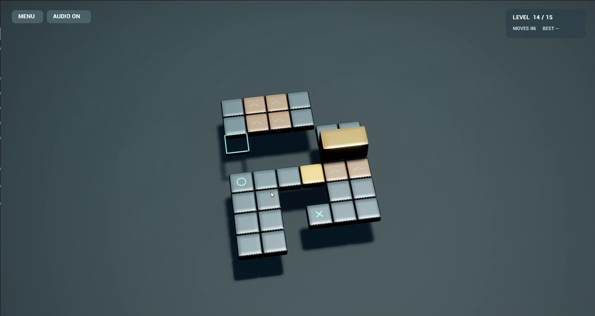

# Bloxorz Unreal

A C++ gameplay-engineering project in **Unreal Engine 5.8**, inspired by a childhood favourite: Bloxorz. The focus is precise grid-based rolling, testable puzzle rules, designer-friendly level authoring, and a cohesive presentation.

[](LinkedIn_Bloxorz_36s.mp4)

[Watch the gameplay highlight](LinkedIn_Bloxorz_36s.mp4) — 36 seconds, 1080p/30 FPS. The edited recording shows rolling, fragile tiles, failure/revive, switches, bridges, and completion. It is a real-time highlights montage, not one uninterrupted playthrough.

## Features

- Deterministic integer-grid movement with upright and two horizontal orientations, correct contact-edge pivots, smooth quarter-turn animation, and a short input buffer.
- Normal/fragile tiles, light toggle switches, upright-only one-shot heavy switches, linked bridge groups, upright-only goals, restart, and three last-valid-state revives per level.
- **15 editable level assets** and an ordered campaign asset. Layouts are no longer compiled into C++.
- **Bloxorz Level Designer:** paint/erase cells, place start/goal markers, link switches and bridges, use Undo/Redo, validate solvability, and launch a selected puzzle.
- Minimal gameplay HUD, animated completion/failure cards, restrained contact/bridge pulses, smaller Niagara completion feedback, and synthesized sound cues.
- An original, seamlessly looping ambient stereo track with fade-in, menu/failure ducking, and audio mute controls.

## Run the project

Use Unreal Engine 5.8 and a supported Windows C++ toolchain. The Development Editor build was verified with **UE 5.8.3**, Visual Studio 2022/MSVC 14.44, and Windows SDK 10.0.26100.

From the repository root in PowerShell:

```powershell
$Engine = 'C:\Program Files\Epic Games\UE_5.8'
$Project = (Resolve-Path '.\BloxorzUnreal.uproject').Path

& "$Engine\Engine\Build\BatchFiles\Build.bat" BloxorzUnrealEditor Win64 Development $Project -WaitMutex -NoHotReloadFromIDE
& "$Engine\Engine\Binaries\Win64\UnrealEditor.exe" $Project
```

Press **Play** in the editor. `/Game/Maps/Puzzle` is intentionally empty: the game mode constructs the board from the campaign assets at runtime. Close the editor normally before rebuilding if it holds the gameplay DLL; preserve unsaved work.

| Action | Control |
|---|---|
| Roll | WASD / arrow keys |
| Restart | R |
| Revive / continue / resume | Enter or Space, when available |
| Pause menu | Escape or Menu button |
| Toggle music and effects | M or Audio button |
| Browse levels | Page Up / Page Down |
| Panel actions | Mouse buttons |

## Create levels without rebuilding

Open **Tools → Bloxorz Level Designer**:

1. Create/select a puzzle and set its grid dimensions and start orientation in Details.
2. Paint tiles, place Start/Goal, and link switch/bridge groups.
3. Choose **Validate / solve**, then **Save** and **Play selected**.
4. Choose **Add to campaign**; use **Campaign order** to reorder the Levels array and save.

Puzzles are stored as `UBloxorzLevelAsset` assets in `/Game/Levels`; `/Game/Levels/DA_Campaign` stores their ordered soft references. `BloxorzCampaign.cpp` only loads those references—it contains no authored layouts. The editor module is separate from runtime gameplay.

This is a **manual grid-authoring tool**, not a random/procedural puzzle generator. A bounded breadth-first solver checks structural validity and finds a solution; reaching the search limit is reported as unknown, not unsolvable.

[Complete Unreal authoring guide](Docs/UnrealLevelAuthoring.md)

## Engineering architecture

| Component | Responsibility |
|---|---|
| `FBloxorzSimulation` | Pure roll transitions, support checks, switch effects, and goal rules; no physics or animation dependencies. |
| `UBloxorzLevelAsset` / `UBloxorzCampaignAsset` | Designer-owned puzzle records and campaign ordering. |
| `ABloxorzBoard` | Pending logical moves, presentation phases, edge-pivot animation, camera fitting, feedback, and audio. |
| `ABloxorzPlayerController` | Discrete commands and UI actions. |
| `ABloxorzHUD` | Scaled canvas UI, modal hit testing, and outcome transitions, isolated in `BloxorzHUD.cpp`. |
| `BloxorzUnrealTools` | Editor-only Slate designer, transactions, validation, asset creation, and standalone preview. |

Each move resolves at the grid level before animation. The Board commits a valid pending state at landing; a failed move preserves the last safe state. Bridges, particles, and camera feedback never determine puzzle outcomes. Core level records and presentation/audio parameters are Blueprint-exposed.

Local progress stores best move counts and progression. Browsing is not unlock-gated; standalone custom-puzzle previews do not write campaign progress. Best moves remain index-keyed, so reordering a shipped campaign requires a save-migration policy.

## Mechanics and reference fidelity

The initial layouts and behavior were ported from the supplied reference project, rather than newly designed for this recreation. Fragile tiles fail only when the block is upright and do not permanently disappear. Support is checked **before** switch effects, with no second support check on that move. Light switches trigger on valid occupied-cell landings, including overlap; heavy switches trigger once per reset while upright.

The supplied reference has no split-block mechanic, so none is claimed here. Completion uses an explicit Continue action. `Docs/UnityCampaign.json` is the extraction snapshot; the one-time migration tool refuses to overwrite existing edited assets. There is no live Unity synchronization.

## Verification

**Verified:** Development Editor compilation; seven passing automation tests; preservation of all 15 reference layouts after asset migration; offscreen completion/failure captures; rendered level-14 and level-15 solutions in 19 and 39 moves respectively.

Run the regression suite:

```powershell
& "$Engine\Engine\Binaries\Win64\UnrealEditor-Cmd.exe" $Project '-ExecCmds=Automation RunTests Bloxorz; Quit' -unattended -nullrhi -nosplash
```

Tests cover the roll table, tile rules, heavy-switch/support ordering, twelve pivot endpoints, asset-backed campaign solvability, authoring validation, and paint/link operations.

**Still pending:** broader interactive authoring/UI edge cases, audio listening/mix review, unusual viewport sizes, packaged Development/Shipping builds, and longer target-hardware profiling. Fixed-timestep replays are behavioral tests—not performance measurements or a sustained-60-FPS claim.

## Presentation and project notes

- [UI/VFX/music update and tuning](Docs/PresentationUpdate.md)
- [Validation evidence and remaining checks](Docs/Validation.md)
- [Architecture/context handoff](PROJECT_CONTEXT.md)
- [Reference-project level-authoring guide](Docs/UnityLevelAuthoring.md)

## Asset provenance

The rounded mesh, materials, synthesized sound cues, and ambient composition were created for this project. `Tools/build_assets.py` and `Tools/build_presentation_update.py` rebuild generated presentation assets through Unreal's Python commandlet. Niagara derives from Epic's bundled RadialBurst template; typography uses bundled Roboto engine-font resources. Those resources retain their respective licenses.

No Friv branding or proprietary presentation assets are included. Reference layouts were supplied by the project owner; this project does not claim ownership of the Bloxorz concept or imply a blanket license for third-party content.
